# xLume 360 v3.0.0

<sub>Redesigned By FreshLabs Interactive</sub>

A new Xbox 360 app and DashLaunch plugin for the [xLume] (https://github.com/Element18592/xLume) (https://github.com/xhjuu/xLume) LED controller.
It uses the same board and the **NEW V3 firmware**. 3D printable board enclosure files available. Aurora cover art available. (See Images Below)

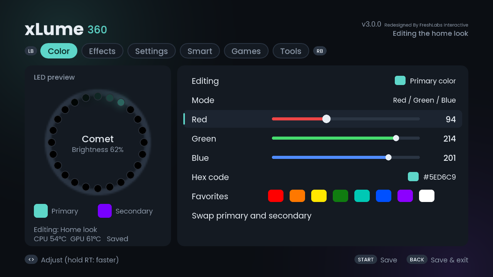
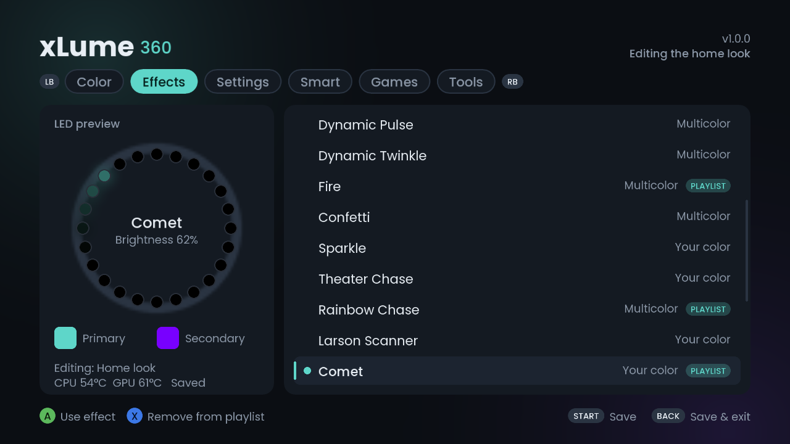
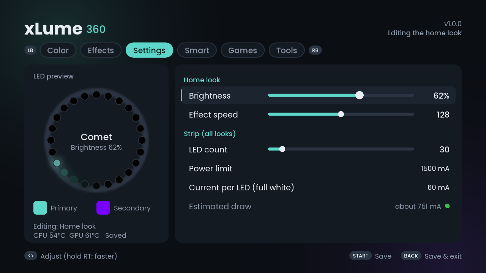
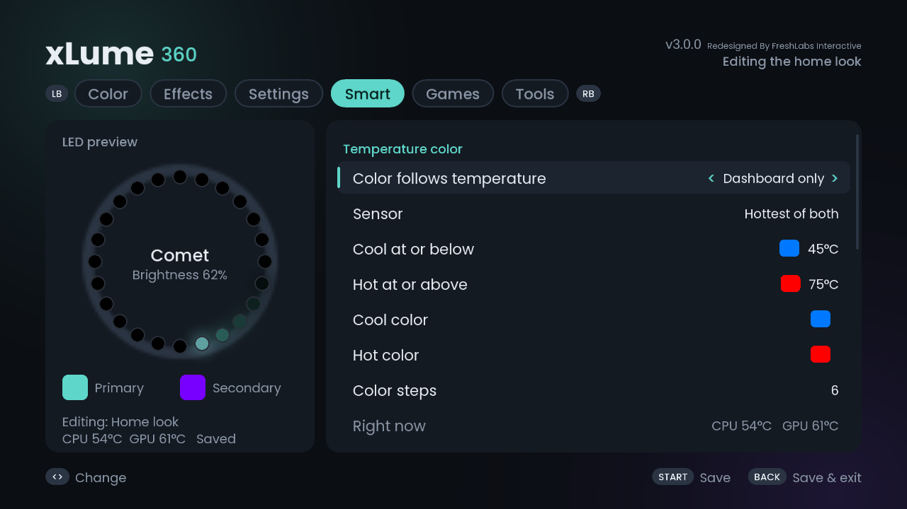
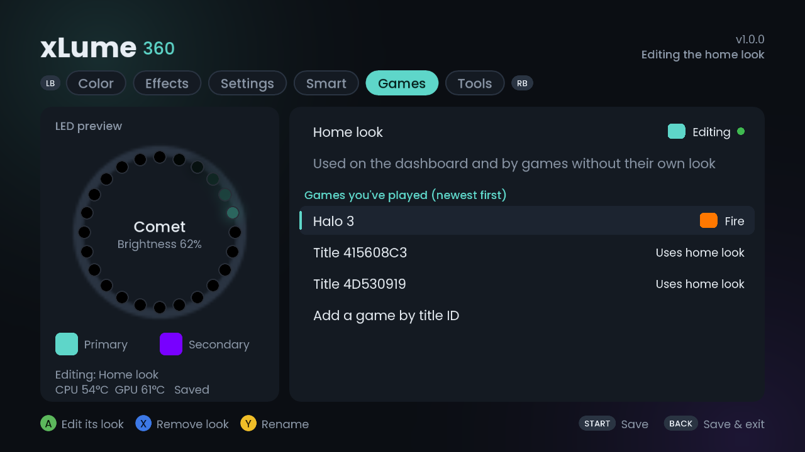
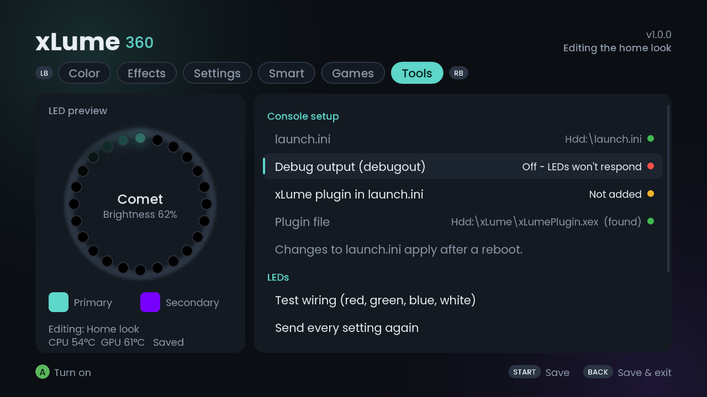
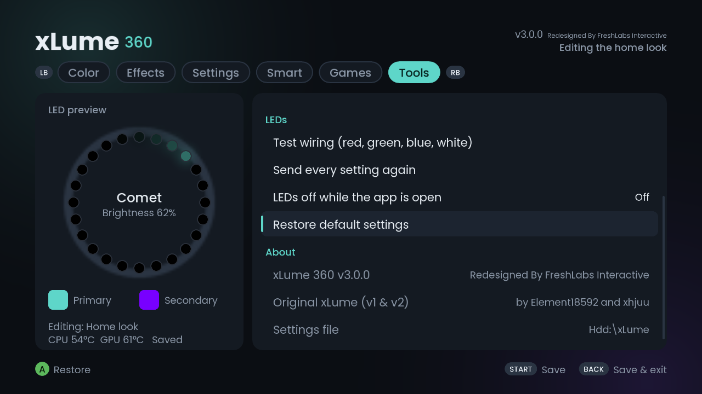
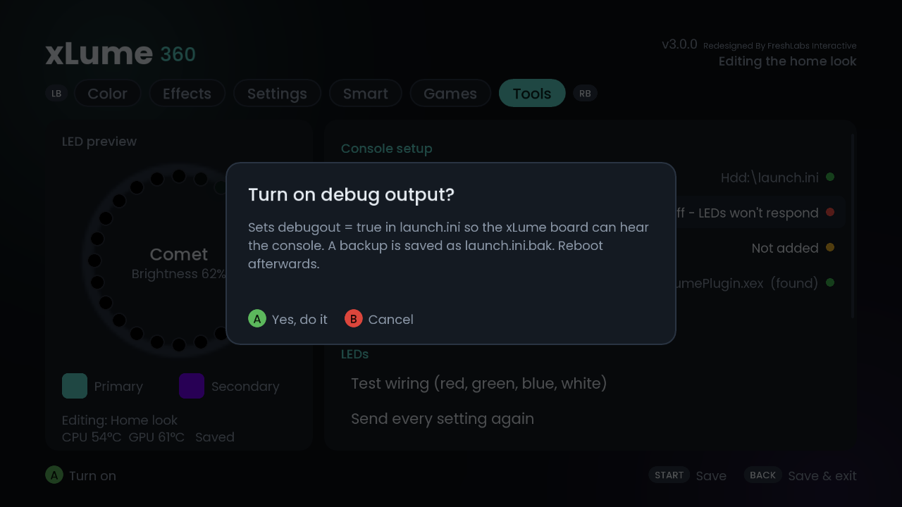
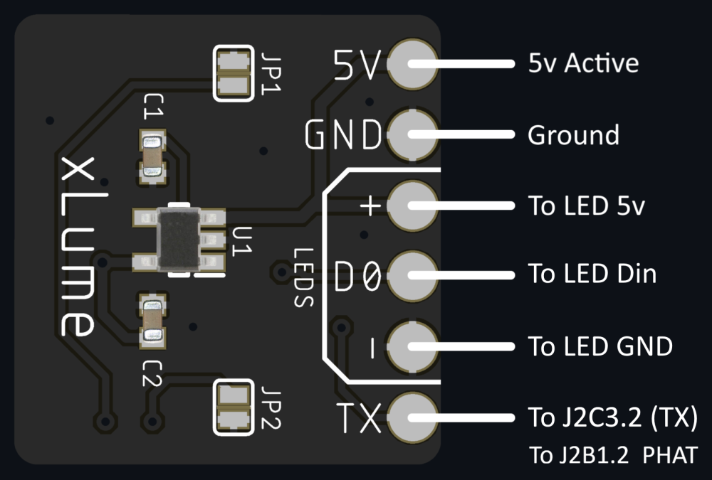
SLIM CONSOLE EXAMPLE

Enclosure Preview
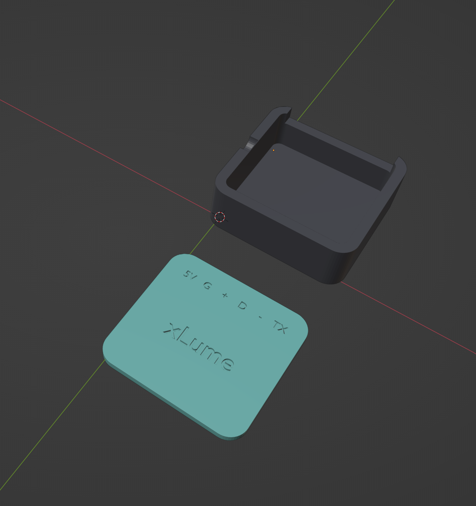
Cover Art
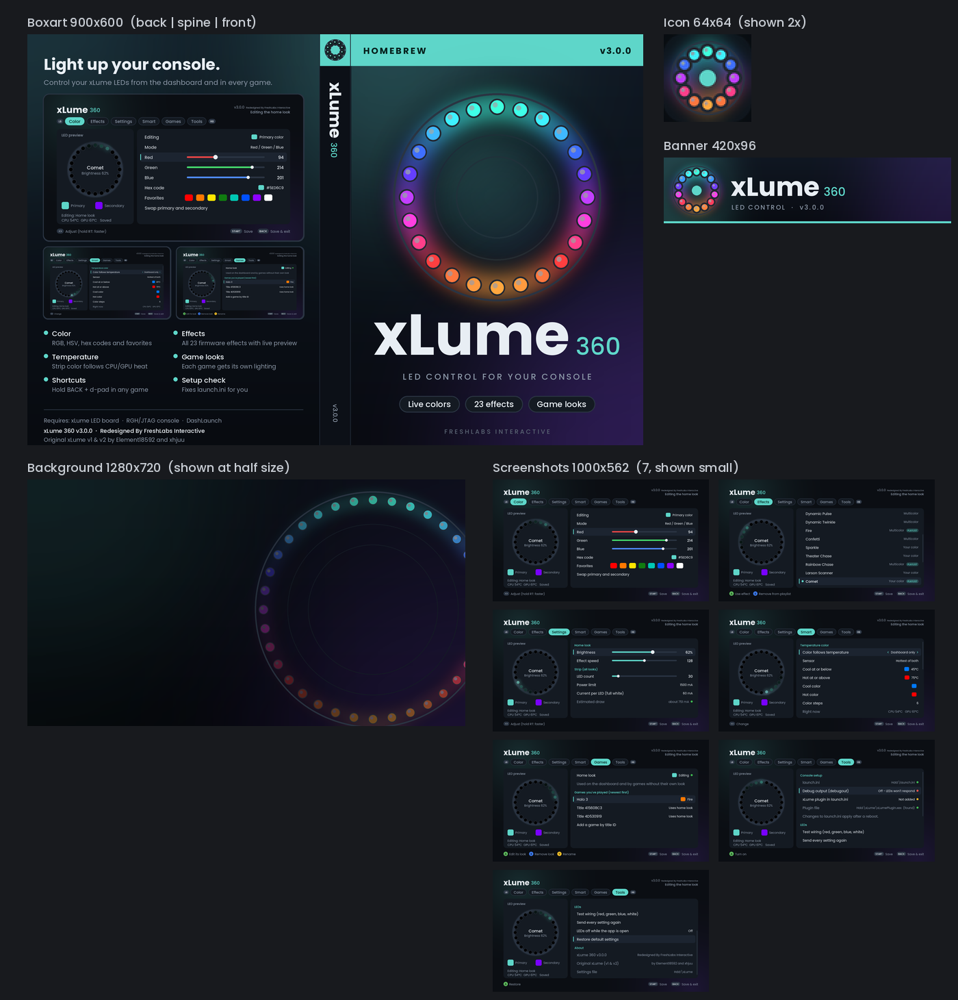

## What's in it

| | Original app | xLume 360 |
|---|---|---|
| Colour picking | RGB sliders | RGB **and** HSV sliders, hex code entry, 8 favourite swatches, swap primary/secondary |
| Effects | 23 effects (V2 & V3) | All 23, with a live animated preview ring |
| Settings | Brightness, speed, LED count | Same, plus a **power limit** that caps brightness to stay under a current budget |
| Runs when | Only while the app is open | A **background plugin** keeps working in games and on the dashboard |
| Temperature colour | – | Strip colour follows CPU/GPU temperature (cool → hot), dashboard-only or always |
| Per-game looks | – | Each game can have its own colour/effect/brightness; switches automatically |
| Event flashes | – | Flash on controller connect/disconnect, profile sign-in, game start |
| In-game shortcuts | – | Hold **BACK** + d-pad: change effect / brightness, RS click = off/on, LS click = reset |
| Effect playlist | – | Rotates through chosen effects every N minutes (in order or shuffled) |
| Setup check | README tells you to edit launch.ini | **Tools** tab checks `debugout`, fixes it, and adds the plugin to `launch.ini` (with a `.bak` backup) |
| Wiring test | – | Red → green → blue → white test, then back to your look |

**Screenshots of every tab are in `Images`.**

## How it talks to the board

Decoded from `Firmware/xLumeV2.bin` (the firmware's own parser was disassembled), so it's exact:

```
[xLume] - Color: r, g, b        [xLume] - Brightness: 0-255
[xLume] - Color2: r, g, b       [xLume] - Speed: 1-255
[xLume] - Effects: 0-22         [xLume] - ledCount: 1-300
```

The console prints these with `DbgPrint`; DashLaunch sends that out of the debug UART when
`debugout = true`. The board's TX-only wire means nothing can be read back from it.

**Flash wear, and why some features are rate-limited.** The V3 firmware saves its state to
flash ~3 seconds after the last change (that's why your look survives a power cycle). Every
lasting change is one flash write, so:
- temperature colours change at most once a minute (configurable, minimum 30 s) and use
  coarse colour steps with hysteresis;
- the playlist interval is at least 10 minutes;
- event flashes and the wiring test last under 2.5 s and then restore the exact previous look,
  so the firmware sees "nothing changed" and doesn't write at all.


## Install

1. Copy both files to `Hdd:\xLume\` (a USB stick at `Usb:\xLume\` also works if there's no HDD):
   ```
   Hdd:\xLume\xLume.xex
   Hdd:\xLume\xLumePlugin.xex
   ```
2. Launch `xLume.xex` from Aurora/FSD/XeXMenu.
3. Open the **Tools** tab (press RB until you get there):
   - *Debug output*: if it's red, press A to turn `debugout` on.
   - *xLume plugin in launch.ini*: press A to add it.
   - Both edits keep a backup at `launch.ini.bak`.
4. Run **Test wiring**. You should see red, green, blue, white.
5. Set up your look, press **START** to save, reboot once so DashLaunch loads the plugin.

The plugin does nothing until `xLume.ini` exists (that is, until you've saved from the app once), so
installing it never changes the look your board already has.

## Controls

| App | |
|---|---|
| LB / RB | Switch tabs |
| D-pad / left stick | Move, adjust (hold to speed up, hold RT for big steps) |
| A / X / Y | Actions shown in the footer for the selected row |
| START | Save |
| BACK | Save and return to your dashboard |

| In any game (plugin) | |
|---|---|
| Hold BACK + d-pad left/right | Previous / next effect |
| Hold BACK + d-pad up/down | Brightness ±12% |
| Hold BACK + right stick click | LEDs off / on |
| Hold BACK + left stick click | Back to the game's normal look |

Shortcut changes last until the next game or dashboard switch. The game also sees these
presses, so turn shortcuts off on the Smart tab if one of your games uses BACK + d-pad.

## Files on the console

| File | Written by | Purpose |
|---|---|---|
| `xLume\xLume.ini` | App | All settings and per-game looks. Plain text; safe to hand-edit if you keep the `[End]` section last. |
| `xLume\titles.txt` | Plugin | Title IDs of games you've played, for the Games tab. |
| `launch.ini.bak` | App | Your previous `launch.ini`, saved before every edit. |


## Credits

xLume 360 v3.0.0 redesigned by FreshLabs Interactive. The original xLume (v1 and v2), its
hardware and firmware are by Element18592 and xhjuu (MIT). UI font: Poppins by Indian Type
Foundry, SIL Open Font License 1.1, rendered into a bitmap atlas.
